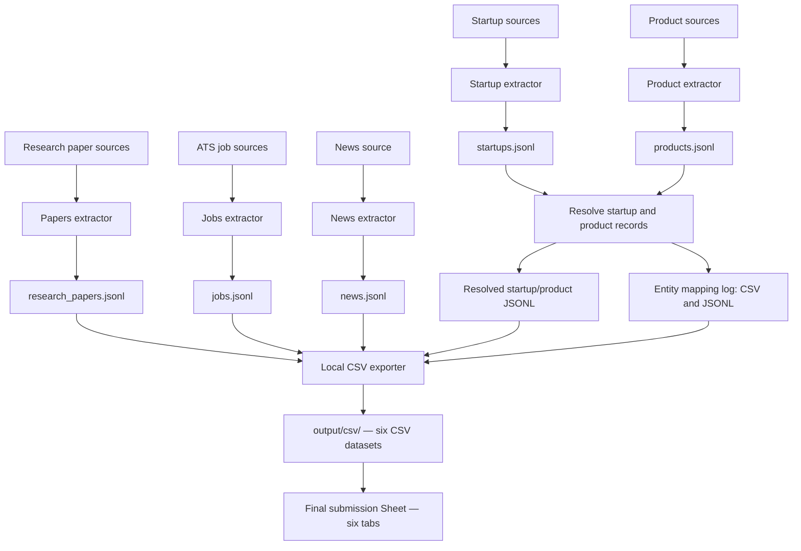
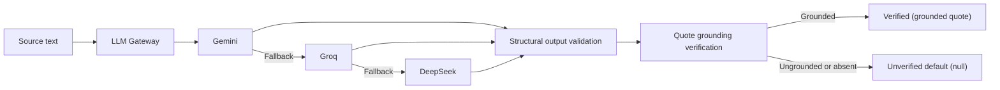

# PaperPled

*FrontierAtlas ingestion pipeline*

## Project Overview

FrontierAtlas is an automated, high-throughput market intelligence pipeline designed to ingest, resolve, normalize, and export entity data across five core AI verticals: Startups, Products, Research Papers, Jobs, and News.

To prevent synthetic inaccuracy, the engine follows a strict anti-hallucination policy:

- LLMs are used exclusively to extract and structure data from verified source text. They do not generate facts, infer entities, or invent sources.
- Every stored record carries immutable provenance, including `source.name`, `source.url`, and `collectedAt` timestamps.
- Pricing models are classified as **Verified (grounded quote)** only when supported by verbatim quotes from fetched source text.
- Ungrounded or absent pricing classifications default to **Unverified default** (`null`).

## Key Features

- Deterministic discovery and extraction across five AI verticals.
- Cross-source entity resolution for startup and product records.
- Local JSONL datasets and UTF-8 CSV exports.
- Dynamic CSV column discovery, including the Entity Mapping Log.
- A resilient multi-provider LLM gateway for grounded pricing analysis.
- Source provenance, date-window filtering, and content fingerprinting.
- Tiered fetching with compliance-first handling of challenge barriers.

## Architecture and Pipeline Overview

The pipeline extracts five vertical datasets, resolves startup and product entities, and exports the datasets together with the entity mapping log. The final submission dataset contains six tabs.



### LLM Pricing Analysis Flow

LLMs are reserved for unstructured pricing analysis. Provider responses are validated and grounded against the source text before a pricing classification is accepted.



## Data Sources

| Vertical | Sources and coverage |
|---|---|
| Startups | Y Combinator indexes. Seed organizations are used for cross-source entity resolution. |
| Products | Hugging Face Spaces and available catalog partitions; products are derived from catalog partitions and YC entities. |
| Research Papers | Hugging Face Daily Papers and arXiv ID batch APIs. |
| Jobs | Ashby ATS boards for tracked organizations. |
| News | Google News RSS. |

The pipeline favors high-signal feeds and structured endpoints over unbounded recursive link crawling.

## Tech Stack

| Area | Technologies and details |
|---|---|
| Runtime | Python and `asyncio`. |
| HTTP and fetching | `httpx`, `curl_cffi`, and Playwright persistent contexts. |
| Parsing | Selectolax (Lexbor), structured JSON, and RSS parsing. |
| LLM gateway | `LLMGateway` with Gemini, Groq, and DeepSeek provider configuration. |
| Data and exports | Local JSONL datasets and UTF-8 CSV files. |
| Tests | `pytest`. |

## Project Structure

```text
.
├── data/                 # Seed entities and pricing sample
├── docs/                 # Project documentation
├── output/               # JSONL datasets, run statistics, and CSV exports
│   └── csv/
├── scripts/              # Project scripts
├── src/
│   ├── core/             # Dates, fetching, HTTP, run stats, and seen store
│   ├── export/           # CSV export
│   ├── llm/              # LLM gateway and grounding
│   ├── resolve/          # Entity resolution
│   └── sources/          # Vertical extractors
├── tests/
├── architecture.md
├── architecture.pdf
├── requirements.txt
└── README.md
```

The CLI entry point is `src/main.py`.

## Installation and Setup

Run these commands from the repository root in PowerShell.

### Prerequisites

- **OS:** Windows 10/11 x64
- **Python:** Python 3.14+ (or Python 3.11+)

### Create and activate a virtual environment

```powershell
python -m venv .venv
```

```powershell
.\.venv\Scripts\Activate.ps1
```

### Install dependencies

Upgrade pip and install the project dependencies:

```powershell
python -m pip install --upgrade pip
pip install -r requirements.txt
```

### Optional browser setup

Install Chromium for Tier 3 Playwright fetching:

```powershell
playwright install chromium
```

## Environment Variables and API Configuration

Create a `.env` file in the repository root. The following lists variable names only; never commit secret values.

```env
# GitHub API Tokens (comma-separated for rotation)
GITHUB_TOKENS=

# Local Pipeline Configuration
OUTPUT_DIR=output

# LLM Gateway: Google Gemini
GEMINI_API_KEY=
GEMINI_MODEL=
GEMINI_RPM=
GEMINI_TPM=
GEMINI_CONTEXT_TOKENS=
GEMINI_MAX_BYTES=

# LLM Gateway: Groq
GROQ_API_KEY=
GROQ_MODEL=
GROQ_RPM=
GROQ_TPM=
GROQ_CONTEXT_TOKENS=
GROQ_MAX_BYTES=

# LLM Gateway: DeepSeek
DEEPSEEK_API_KEY=
DEEPSEEK_MODEL=
DEEPSEEK_RPM=
DEEPSEEK_TPM=
DEEPSEEK_CONTEXT_TOKENS=
DEEPSEEK_MAX_BYTES=
```

## Execution Commands

Run all extractors with a minimum target limit of 1,000 records per vertical:

```powershell
python -m src.main all --limit 1000
```

Run only the Ashby ATS jobs extractor (24-hour freshness window):

```powershell
python -m src.main jobs
```

Run only the Google News RSS extractor (24-hour freshness window):

```powershell
python -m src.main news
```

Run cross-source entity resolution against seed organizations:

```powershell
python -m src.main resolve
```

Export all datasets to `output\csv\` as UTF-8 CSV files:

```powershell
python -m src.main export --tabs "Startups,Products,Research Papers,Jobs,News,Entity Mapping Log"
```

## Pipeline Workflow

1. Run the required vertical extractor command or run all extractors.
2. Run entity resolution against the seed organizations.
3. Export the JSONL datasets and entity mapping log as local CSV files.
4. Use the six exported datasets for the final submission Sheet.

The extraction, resolution, and export commands can also be run separately using the commands above.

## Dataset Outputs

- The five vertical datasets are stored as JSONL files under `output/`.
- Entity resolution writes `output/entity_mapping_log.jsonl` and `output/entity_mapping_log.csv`.
- CSV exports are written under `output/csv/`.
- The Entity Mapping Log CSV columns are discovered from the JSONL records; the schema is not hardcoded in the exporter.

## Dataset Statistics and Measured Results

The statistics below reflect recorded values in `output/run_stats.json` and local dataset outputs.

### Final Submission Dataset

The final submission contains six tabs: Startups, Products, Research Papers, Jobs, News, and Entity Mapping Log.

**Final submission Sheet:** https://docs.google.com/spreadsheets/d/16Bn0Pj60wshv3YPh7Fdw8E-UjkiUtXfd-gki21dhCjA/edit?usp=sharing

Verified accessible in an Incognito window with Anyone-with-link Viewer sharing.

| Tab / dataset | Output file | Recorded output rows | Freshness window | Pricing classification status |
|---|---|---:|---|---|
| **Startups** | `startups.jsonl` | 1000 | Static catalog | N/A |
| **Products** | `products.jsonl` | 1000 | Directory index | 1000 Unverified default (`null`), 0 Verified (grounded quote) |
| **Research Papers** | `research_papers.jsonl` | 1000 | Last 180 days | N/A |
| **Jobs** | `jobs.jsonl` | 24 | < 24 hours (`2026-11-21T19:13:50Z`) | N/A |
| **News** | `news.jsonl` | 71 | < 24 hours (`2026-11-21T19:13:53Z`) | N/A |
| **Entity Mapping Log** | `entity_mapping_log.csv` | 2000 | Cross-vertical run | N/A |
| **Total Run Duration** | — | Not measured in this run | — | — |

### LLM Gateway and Provider Statistics

Recorded metrics from the multi-provider resilient fallback orchestrator (`run_stats.json`):

| Provider | Requests | HTTP 429 | HTTP 413 / Overflow | Fallback Triggered | OK (200) | Ungrounded Output |
|---|---:|---:|---:|---:|---:|---:|
| **primary** | 1 | 1 | 1 | 1 | 1 | 0 |
| **backup** | 1 | 0 | 0 | 0 | 1 | 0 |
| **gemini** | 1 | 0 | 0 | 0 | 0 (HTTP 403) | 0 |
| **groq** | 1 | 0 | 0 | 0 | 1 (HTTP 404 handled) | 1 |
| **DeepSeek** | Not configured in this run (Gemini 403; Groq carried the chain) | — | — | — | — | — |

## Design Decisions

- **Deterministic Discovery Over Web Crawling:** Ingests high-signal feeds (Hugging Face Daily Papers, arXiv ID batch APIs, Y Combinator indexes, Ashby ATS endpoints) rather than executing unbounded recursive link crawling.
- **Deterministic-First Extraction:** High-speed Lexbor DOM parsing and structured API payloads extract schema attributes deterministically; LLMs are used only for unstructured pricing analysis.
- **Resilient LLM Cascades:** `LLMGateway` implements sequential multi-provider failover (`Gemini -> Groq -> DeepSeek`), rolling RPM/TPM concurrency windows, payload shrink-on-overflow (60% stepdown), and full-jitter backoff on 429 rate limits.
- **Strict Grounding Enforcement:** Extracted pricing proposals require verbatim line-level evidence matching both the source document and model prompt; ungrounded outputs are discarded to `null`.
- **Hybrid Deduplication and Freshness:** Closed UTC interval parsing (`earliest`, `latest`) enforces strict 24-hour freshness boundaries. Canonical URL normalization and SHA-256 content fingerprinting prevent duplicate ingestion.
- **Tiered Anti-Bot Architecture:** Tier 1 (`httpx`) escalates to Tier 2 (`curl_cffi` browser impersonation) and Tier 3 (`Playwright` persistent context) upon encountering challenge signals; hard blocks halt safely at Tier 4 without attempting captcha circumvention.

## Testing

Run the test suite from the repository root:

```powershell
python -m pytest -q
```

## Future Improvements

The architecture specification describes the following items as designed, not implemented locally:

- A Postgres-backed frontier queue with `SKIP LOCKED` task leasing and stateless workers.
- Immutable raw-payload archiving in object storage such as S3/GCS; the local implementation stores JSONL files under `output/`.
- Redis-based leases for distributed seen-store claims.
- Postgres as the persistent catalog, with pgvector for entity embeddings and a Neo4j graph projection.

## Limitations

- **Hugging Face Spaces Capping:** The Hugging Face Spaces API limits unauthenticated traversal batches. Products are derived from available catalog partitions and YC entities; pricing is marked **Verified (grounded quote)** only when an explicit source quote is validated, and remains **Unverified default** otherwise.
- **ATS Coverage Scope:** Job tracking covers only configured ATS platforms (Ashby boards for tracked organizations: Cursor, OpenAI, Perplexity, Cerebras, Harvey); unconfigured company boards or non-Ashby portals are not indexed.
- **News Freshness Dependency:** Google News RSS enforces a rolling 24-hour window evaluated relative to the execution timestamp `now()`. Total record counts vary directly depending on news volume at run time.
- **Anti-Bot Compliance Boundaries:** The pipeline does **not** bypass Cloudflare or DataDome. If challenge barriers or captchas are encountered, the fetcher logs challenge signals, adjusts adaptive backoff, and halts at Tier 4. Protected or ToS-restricted sources must be accessed via licensed APIs or authorized partnerships.
